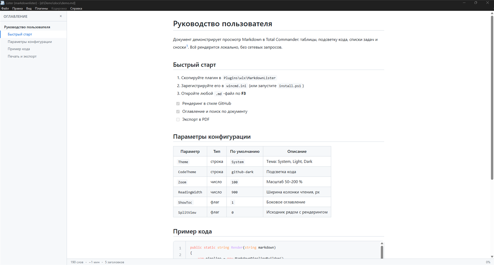
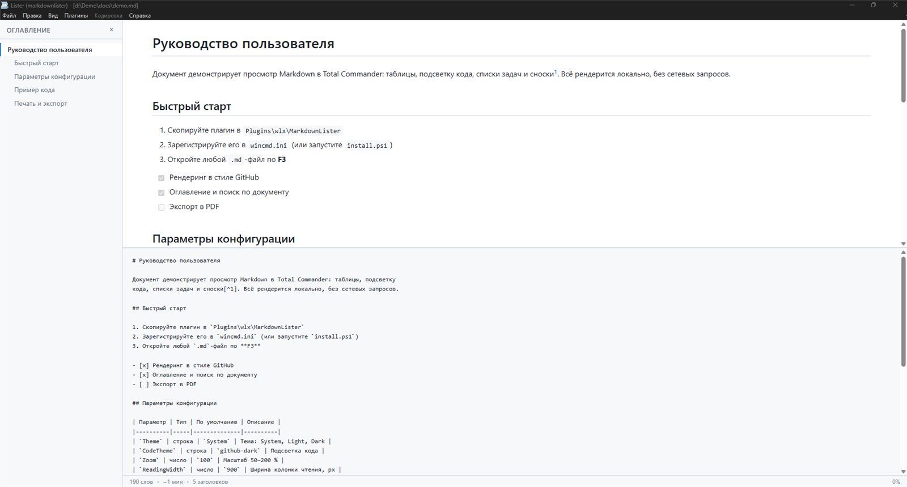
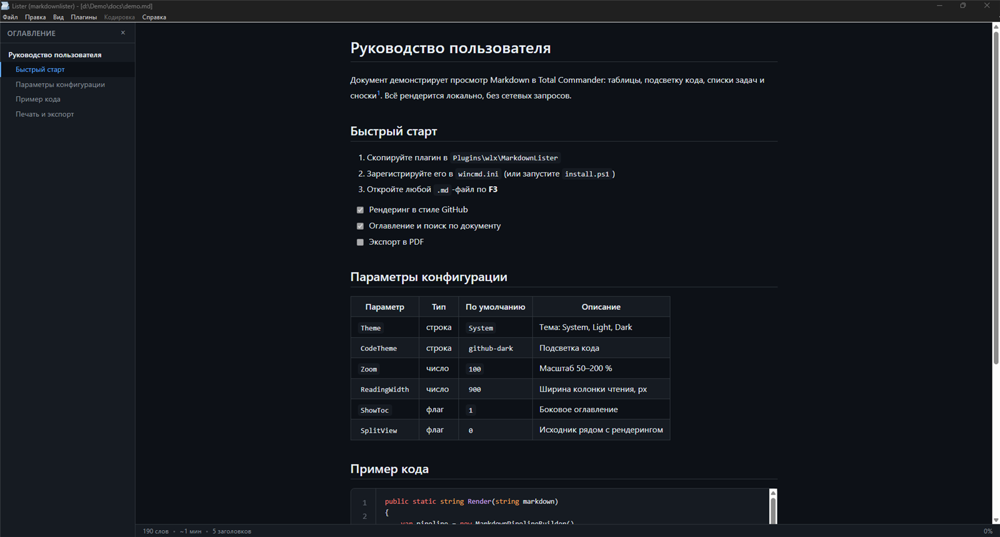
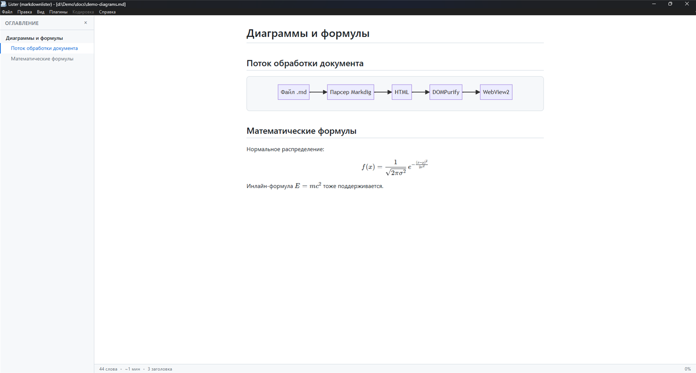
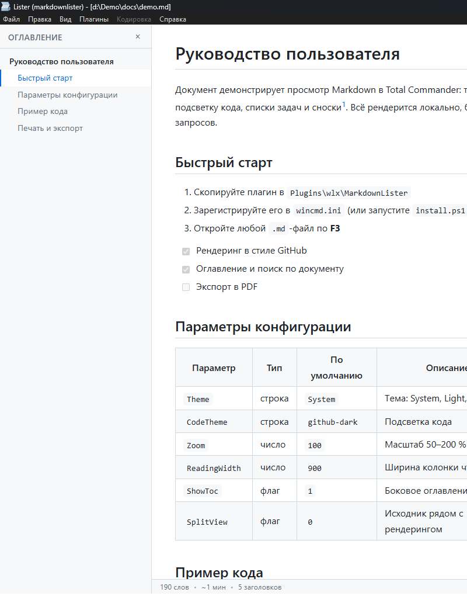

# MarkdownLister

**English** | [Русский](README.md)

<p align="center">
  <b>Markdown viewer for Total Commander</b><br>
  <sub>WLX plugin: GitHub-style rendering, split view, Mermaid, KaTeX — right in Lister</sub>
</p>

<p align="center">
  <a href="https://github.com/StarLeG/tc-markdown-lister/releases/latest"></a>
  <a href="https://github.com/StarLeG/tc-markdown-lister/blob/main/LICENSE"></a>
  <a href="https://github.com/StarLeG/tc-markdown-lister"></a>
  <a href="https://github.com/StarLeG/tc-markdown-lister"></a>
  <a href="https://github.com/StarLeG/tc-markdown-lister"></a>
</p>

<p align="center">
  
</p>

View Markdown files with <b>F3</b> (Lister) and in Quick View (<b>Ctrl+Q</b>) —
for <code>.md</code>, <code>.markdown</code>, <code>.mkd</code>, <code>.mdown</code>, <code>.mdx</code>.
GFM rendering, split view with scroll sync, themes, search, table of contents, PDF export —
fully local, no telemetry.

<p align="center">
  <a href="https://github.com/StarLeG/tc-markdown-lister/releases/latest"><b>⬇ Download</b></a>
  &nbsp;|&nbsp;
  <a href="#quick-start"><b>🚀 Quick Start</b></a>
  &nbsp;|&nbsp;
  <a href="#settings"><b>⚙️ Settings</b></a>
</p>

## Contents

- [Features](#features)
- [Quick Start](#quick-start)
- [Installation](#installation)
- [Screenshots](#screenshots)
- [Settings](#settings)
- [Building from Source](#building-from-source)
- [Project Structure](#project-structure)
- [Author](#author)
- [Support the Project](#support-the-project)
- [License](#license)

## Features

| | |
|---|---|
| 🖼 | **GitHub-style rendering** — GFM tables, task lists, footnotes, YAML front matter, heading anchors |
| ✂️ | **Split view** (`Ctrl+M`) — source next to the rendering, with scroll sync |
| 🎨 | **Appearance** — System / Light / Dark themes + 6 JSON presets; highlight.js code coloring (5 themes), reading column width 600–2000 px, zoom 50–200 % |
| 📊 | **Diagrams and formulas** — Mermaid.js and KaTeX out of the box |
| 🧭 | **Navigation** — table of contents (TOC) in the sidebar, in-document search (including code blocks) |
| 📚 | **Large files** — async loading and progressive chunked rendering (verified with a 100 MB file), progress indicator, warning and lightweight mode from 5 MB |
| 📤 | **Export** — PDF, print, standalone HTML |
| ⚙️ | **Reliability** — encoding detection (UTF-8/UTF-16/ANSI via UTF.Unknown), protection against huge files, error logging, INI settings, fully local with no telemetry |

## Quick Start

1. **Download** the release archive `MarkdownLister-<version>.zip` from [Releases](https://github.com/StarLeG/tc-markdown-lister/releases/latest).
2. **Install**: extract it and run `install.ps1` (Total Commander is detected automatically) — or double-click `pluginst.inf` right in Total Commander. Details are in [Installation](#installation).
3. **Open** any `.md` in Total Commander with `F3` — the Markdown renders GitHub-style.

**Requirements:** Windows; Total Commander (32- or 64-bit); [WebView2 Runtime](https://developer.microsoft.com/microsoft-edge/webview2/) (usually already installed with Edge).

## Installation

### Installation Script

```powershell
# from src\MarkdownLister.Setup after building (dist\ is required)
.\install.ps1                                 # Total Commander is detected automatically
.\install.ps1 -TotalCommanderDir "C:\totalcmd" # or specify the path explicitly
```

The script copies the plugin to `<TC>\Plugins\wlx\MarkdownLister\` and registers it in `wincmd.ini`. Restart Total Commander. To remove: `uninstall.ps1`.

### Installing from a Zip (pluginst.inf)

`src\MarkdownLister.Setup\pluginst.inf` — for installing from a zip archive by double-click in Total Commander (the standard TC plugin mechanism).

<details>
<summary><b>Manual installation and wincmd.ini registration</b></summary>

1. Copy `dist\x86\*` and `dist\x64\MarkdownLister.wlx64` into a single folder `<TC>\Plugins\wlx\MarkdownLister\` (`MarkdownLister.wlx` + `MarkdownLister.wlx64` side by side).
2. In `wincmd.ini`, add to the `[ListerPlugins]` section (`N` is the next free number):

```ini
[N]=%COMMANDER_PATH%\Plugins\wlx\MarkdownLister\MarkdownLister.wlx
[N]_detect="EXT="MD" | EXT="MARKDOWN" | EXT="MKD" | EXT="MDOWN" | EXT="MDX""
```

3. Restart Total Commander.

</details>

## Screenshots

<p align="center">
  
</p>
<p align="center"><i>Split view (Ctrl+M): source and rendering with scroll sync</i></p>

<p align="center">
  
</p>
<p align="center"><i>Dark appearance theme</i></p>

<p align="center">
  
</p>
<p align="center"><i>Mermaid diagrams and KaTeX formulas</i></p>

<p align="center">
  
</p>
<p align="center"><i>Table of contents (TOC) in the sidebar</i></p>

## Settings

The INI file `MarkdownLister.ini` is created next to the plugin:

```ini
[View]
Theme=System        ; System | Light | Dark
CodeTheme=github-dark
Zoom=100            ; 50..200
ReadingWidth=900    ; 600..2000
```

<details>
<summary><b>Full settings list and JSON theme presets</b></summary>

```ini
[View]
ThemePreset=        ; preset name from themes\ (without .json), empty = no preset
Theme=System        ; System | Light | Dark
CodeTheme=github-dark
Zoom=100            ; 50..200
ReadingWidth=900    ; 600..2000
ShowLineNumbers=1
ShowToc=1
SplitView=0
[General]
LogErrors=1
LargeFileWarningMb=5 ; from this size, MB — warning and large-file mode:
                     ; progressive rendering, heavy extras disabled
                     ; (highlighting, Mermaid, KaTeX, line numbers)
```

### JSON Theme Presets

The `themes/` folder contains editable presets (`system.json`, `light.json`, `dark.json`, `solarized-light.json`, `solarized-dark.json`, `monokai.json`):

```json
{
  "name": "Dark",
  "theme": "Dark",
  "codeTheme": "github-dark",
  "zoom": 100,
  "readingWidth": 900,
  "showLineNumbers": true,
  "showToc": true
}
```

Select a preset with `ThemePreset=<file-name-without-.json>` in the INI. Application order: defaults → preset → INI (INI entries are more specific and win). Corrupted JSON is silently ignored.

</details>

## Building from Source

```powershell
.\build.ps1                # Release x86 + x64, export check, dist\
.\build.ps1 -NoDist        # build and check only
.\build.ps1 -Configuration Debug
```

The script requires Visual Studio 2022 (or BuildTools) with MSBuild. Output:

```
dist\x86\MarkdownLister.wlx      # for 32-bit Total Commander
dist\x64\MarkdownLister.wlx64    # for 64-bit Total Commander
```

Every build is checked for the full unmanaged export of the WLX functions (11 in total) — without them Lister will not see the plugin.

The project also opens in Visual Studio: `MarkdownLister.sln` (Debug/Release × Any CPU/x86/x64 configurations).

## Project Structure

```
src/
├── MarkdownLister.WLX/    # WLX entry point, function exports, WebView2 host
├── MarkdownLister.Core/   # Markdown parsing, settings, statistics
├── MarkdownLister.Web/    # HTML/CSS/JS template, highlight.js, Mermaid, KaTeX, DOMPurify
└── MarkdownLister.Setup/  # install.ps1, uninstall.ps1, pluginst.inf
themes/                    # JSON theme presets
build.ps1                  # x86/x64 build + export check + dist
```

## Author

Старинский Олег Григорьевич (Oleg Starinsky)

- Email: info@electroman.by
- Telegram: [@ElectroManBY](https://t.me/ElectroManBY)

## Support the Project

Any amount, in a minute — there is no fixed price: you choose the amount and the occasion. Most convenient from a phone.

| | |
|---|---|
| 💳 | **ЮMoney** — any bank card, no registration: wallet `4100119514684342` ([pay →](https://yoomoney.ru/to/4100119514684342)) |
| 💰 | **WebMoney** — [donation page →](https://pay.web.money/d/1kji) or [WebMoney bot on Telegram →](https://t.me/WebMoneyWalletBot/donate?startapp=1kji) |
| 🏦 | **IBAN top-up (Belarus)** — from another bank's online banking or app (not Sber Bank), paying via ERIP (Banking & financial services → Banks, NPOs & NFOs → Sber Bank → Card account top-up): account `BY18 BPSB 3014 F000 0000 1164 7609`. Sber Bank customers — transfer by phone number `+375 29 714-28-82` |
| 📱 | **SberBank (Russia)** — in SberBank Online: a transfer to Belarus by phone number `+375 29 714-28-82` (the recipient is a customer of Sber Bank (Belarus)) |

Before the transfer, the app will show the recipient's name — please verify it.

**Not only with money:** a bug report or telling colleagues on a forum helps the project just as much.

## License

[MIT](LICENSE)
