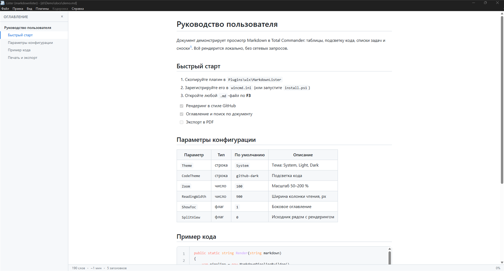
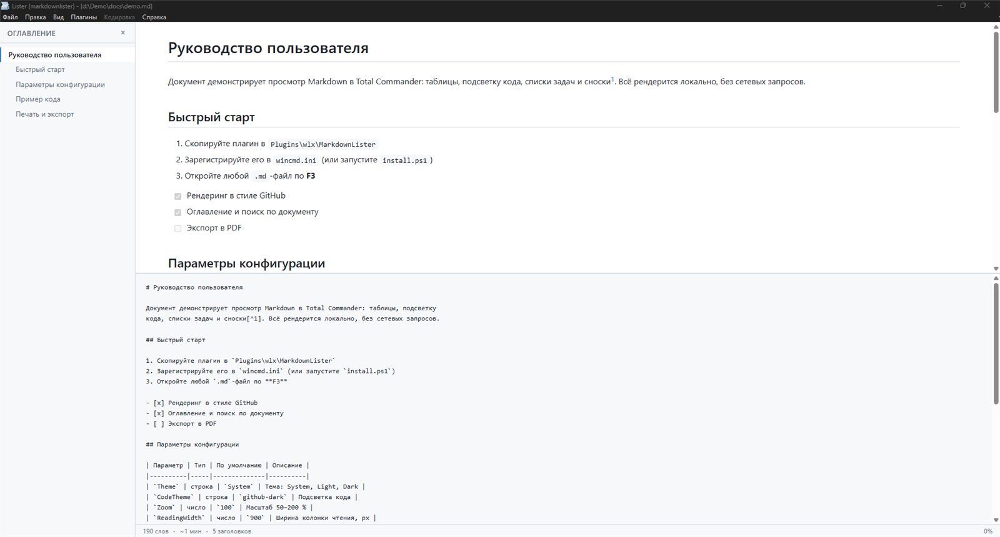
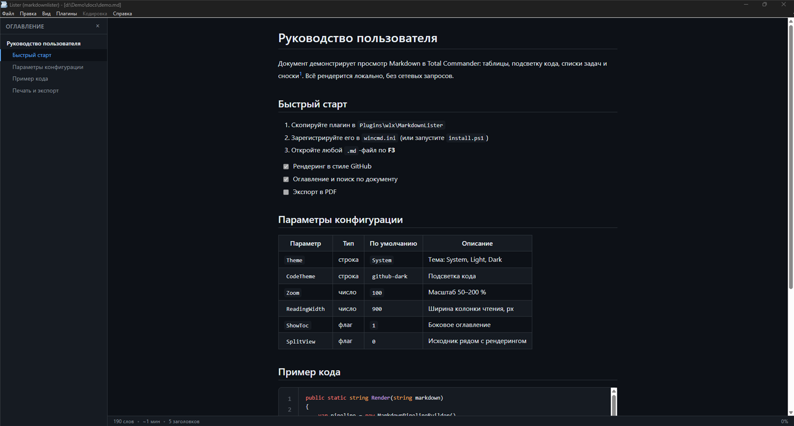
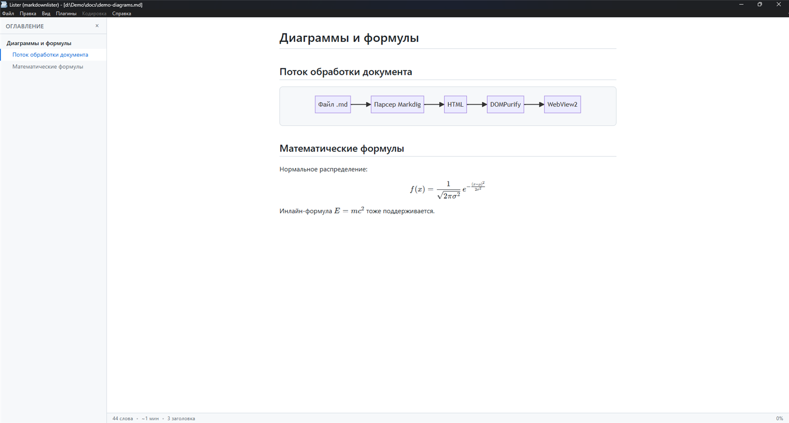
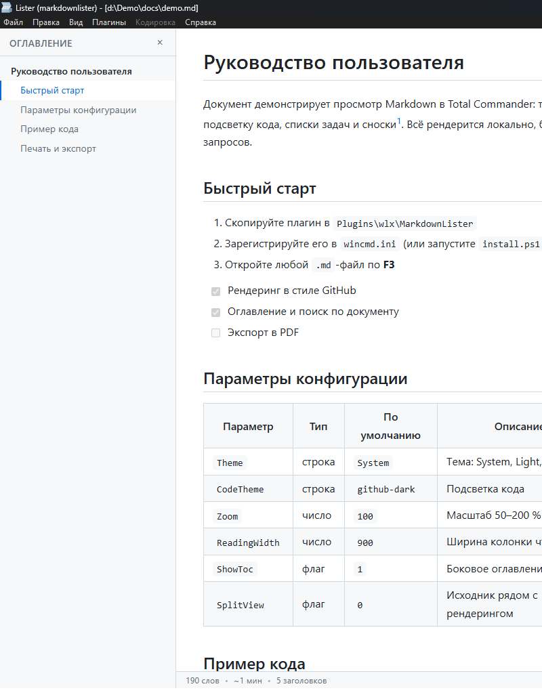

# MarkdownLister

<p align="center">
  <b>Markdown-просмотрщик для Total Commander</b><br>
  <sub>WLX-плагин: рендеринг в стиле GitHub, split view, Mermaid, KaTeX — прямо в Lister</sub>
</p>

<p align="center">
  <a href="https://github.com/StarLeG/tc-markdown-lister/releases/latest"></a>
  <a href="https://github.com/StarLeG/tc-markdown-lister/blob/main/LICENSE"></a>
  <a href="https://github.com/StarLeG/tc-markdown-lister"></a>
  <a href="https://github.com/StarLeG/tc-markdown-lister"></a>
  <a href="https://github.com/StarLeG/tc-markdown-lister"></a>
</p>

<p align="center">
  
</p>

Просмотр Markdown-файлов по <b>F3</b> (Lister) и в Quick View (<b>Ctrl+Q</b>) —
для <code>.md</code>, <code>.markdown</code>, <code>.mkd</code>, <code>.mdown</code>, <code>.mdx</code>.
GFM-рендеринг, split view с синхронизацией прокрутки, темы, поиск, оглавление, экспорт в PDF —
полностью локально, без телеметрии.

<p align="center">
  <a href="https://github.com/StarLeG/tc-markdown-lister/releases/latest"><b>⬇ Скачать релиз</b></a>
  &nbsp;|&nbsp;
  <a href="#быстрый-старт"><b>🚀 Быстрый старт</b></a>
  &nbsp;|&nbsp;
  <a href="#настройки"><b>⚙️ Настройки</b></a>
</p>

## Содержание

- [Возможности](#возможности)
- [Быстрый старт](#быстрый-старт)
- [Установка](#установка)
- [Скриншоты](#скриншоты)
- [Настройки](#настройки)
- [Сборка из исходников](#сборка-из-исходников)
- [Структура проекта](#структура-проекта)
- [Автор](#автор)
- [Поддержать проект](#поддержать-проект)
- [Лицензия](#лицензия)

## Возможности

| | |
|---|---|
| 🖼 | **Рендеринг в стиле GitHub** — GFM-таблицы, списки задач, сноски, YAML front matter, якоря заголовков |
| ✂️ | **Split view** (`Ctrl+M`) — исходник рядом с рендерингом, с синхронизацией прокрутки |
| 🎨 | **Оформление** — темы System / Light / Dark + 6 JSON-пресетов; подсветка кода highlight.js (5 тем), ширина колонки чтения 600–2000 px, зум 50–200 % |
| 📊 | **Диаграммы и формулы** — Mermaid.js и KaTeX из коробки |
| 🧭 | **Навигация** — оглавление (TOC) в боковой панели, поиск по документу |
| 📤 | **Экспорт** — PDF, печать, автономный HTML |
| ⚙️ | **Надёжность** — определение кодировки (UTF-8/UTF-16/ANSI через UTF.Unknown), защита от тяжёлых файлов, логирование ошибок, INI-настройки, полностью локально без телеметрии |

## Быстрый старт

1. **Скачайте** архив релиза `MarkdownLister-<версия>.zip` из [Releases](https://github.com/StarLeG/tc-markdown-lister/releases/latest).
2. **Установите**: распакуйте и запустите `install.ps1` (Total Commander найдётся автоматически) — либо дважды кликните `pluginst.inf` прямо в Total Commander. Подробности — в [Установке](#установка).
3. **Откройте** любой `.md` в Total Commander по `F3` — Markdown отрендерится в стиле GitHub.

**Требования:** Windows; Total Commander (32- или 64-битный); [WebView2 Runtime](https://developer.microsoft.com/microsoft-edge/webview2/) (обычно уже установлен вместе с Edge).

## Установка

### Установочный скрипт

```powershell
# из каталога src\MarkdownLister.Setup после сборки (dist\ обязателен)
.\install.ps1                                 # Total Commander найдётся автоматически
.\install.ps1 -TotalCommanderDir "C:\totalcmd" # или укажите путь явно
```

Скрипт скопирует плагин в `<TC>\Plugins\wlx\MarkdownLister\` и зарегистрирует его в `wincmd.ini`. Перезапустите Total Commander. Удаление — `uninstall.ps1`.

### Установка из zip (pluginst.inf)

`src\MarkdownLister.Setup\pluginst.inf` — для установки из zip-архива двойным кликом в Total Commander (штатный механизм TC-плагинов).

<details>
<summary><b>Ручная установка и регистрация в wincmd.ini</b></summary>

1. Скопируйте `dist\x86\*` и `dist\x64\MarkdownLister.wlx64` в одну папку `<TC>\Plugins\wlx\MarkdownLister\` (имена: `MarkdownLister.wlx` + `MarkdownLister.wlx64` рядом).
2. В `wincmd.ini` добавьте в секцию `[ListerPlugins]` (номер `N` — следующий свободный):

```ini
[N]=%COMMANDER_PATH%\Plugins\wlx\MarkdownLister\MarkdownLister.wlx
[N]_detect="EXT="MD" | EXT="MARKDOWN" | EXT="MKD" | EXT="MDOWN" | EXT="MDX""
```

3. Перезапустите Total Commander.

</details>

## Скриншоты

<p align="center">
  
</p>
<p align="center"><i>Split view (Ctrl+M): исходник и рендеринг с синхронизацией прокрутки</i></p>

<p align="center">
  
</p>
<p align="center"><i>Тёмная тема оформления</i></p>

<p align="center">
  
</p>
<p align="center"><i>Диаграммы Mermaid и формулы KaTeX</i></p>

<p align="center">
  
</p>
<p align="center"><i>Оглавление (TOC) в боковой панели</i></p>

## Настройки

INI-файл `MarkdownLister.ini` создаётся рядом с плагином:

```ini
[View]
Theme=System        ; System | Light | Dark
CodeTheme=github-dark
Zoom=100            ; 50..200
ReadingWidth=900    ; 600..2000
```

<details>
<summary><b>Полный список настроек и JSON-пресеты тем</b></summary>

```ini
[View]
ThemePreset=        ; имя пресета из themes\ (без .json), пусто — без пресета
Theme=System        ; System | Light | Dark
CodeTheme=github-dark
Zoom=100            ; 50..200
ReadingWidth=900    ; 600..2000
ShowLineNumbers=1
ShowToc=1
SplitView=0
[General]
LogErrors=1
LargeFileWarningMb=5
```

### JSON-пресеты тем

Папка `themes/` содержит редактируемые пресеты (`system.json`, `light.json`, `dark.json`, `solarized-light.json`, `solarized-dark.json`, `monokai.json`):

```json
{
  "name": "Dark",
  "theme": "Dark",
  "codeTheme": "github-dark",
  "zoom": 100,
  "readingWidth": 900,
  "showLineNumbers": true,
  "showToc": true
}
```

Выбор пресета — `ThemePreset=<имя-файла-без-.json>` в INI. Порядок применения: значения по умолчанию → пресет → INI (записи INI персональнее и побеждают). Повреждённый JSON молча игнорируется.

</details>

## Сборка из исходников

```powershell
.\build.ps1                # Release x86 + x64, проверка экспорта, dist\
.\build.ps1 -NoDist        # только собрать и проверить
.\build.ps1 -Configuration Debug
```

Скрипт требует Visual Studio 2022 (или BuildTools) с MSBuild. Результат:

```
dist\x86\MarkdownLister.wlx      # для 32-битного Total Commander
dist\x64\MarkdownLister.wlx64    # для 64-битного Total Commander
```

Каждая сборка проверяется на полный unmanaged-экспорт WLX-функций (11 шт.) — без них Lister не увидит плагин.

Проект также открывается в Visual Studio: `MarkdownLister.sln` (конфигурации Debug/Release × Any CPU/x86/x64).

## Структура проекта

```
src/
├── MarkdownLister.WLX/    # точка входа WLX, экспорт функций, WebView2-хост
├── MarkdownLister.Core/   # парсинг Markdown, настройки, статистика
├── MarkdownLister.Web/    # HTML/CSS/JS-шаблон, highlight.js, Mermaid, KaTeX, DOMPurify
└── MarkdownLister.Setup/  # install.ps1, uninstall.ps1, pluginst.inf
themes/                    # JSON-пресеты тем
build.ps1                  # сборка x86/x64 + проверка экспорта + dist
```

## Автор

Старинский Олег Григорьевич

- Email: info@electroman.by
- Telegram: [@ElectroManBY](https://t.me/ElectroManBY)

## Поддержать проект

Любая сумма, за минуту — фиксированного прайса нет: сумму и повод выбираете сами.
Удобнее всего с телефона.

| | |
|---|---|
| 💳 | **ЮMoney** — картой любого банка, без регистрации: кошелёк `4100119514684342` ([перевести →](https://yoomoney.ru/to/4100119514684342)) |
| 💰 | **WebMoney** — [страница доната →](https://pay.web.money/d/1kji) или [бот WebMoney в Telegram →](https://t.me/WebMoneyWalletBot/donate?startapp=1kji) |
| 🏦 | **Пополнение счёта по IBAN (Беларусь)** — из интернет-банка или приложения другого банка, не Сбер Банка, оплатой через ЕРИП (Банковские, финансовые услуги → Банки, НКО и НФО → Сбер Банк → Пополнение счёта картой): счёт `BY18 BPSB 3014 F000 0000 1164 7609`. Клиентам Сбер Банка — перевод по номеру телефона `+375 29 714-28-82` |
| 📱 | **СберБанк (Россия)** — в СберБанк Онлайн: перевод в Беларусь по номеру телефона `+375 29 714-28-82` (получатель — клиент Сбер Банка (Беларусь)) |

Перед переводом приложение покажет имя получателя — проверьте его.

**Не только деньгами:** отчёт о баге или рассказ коллегам на форуме помогают проекту не меньше.

## Лицензия

[MIT](LICENSE)
